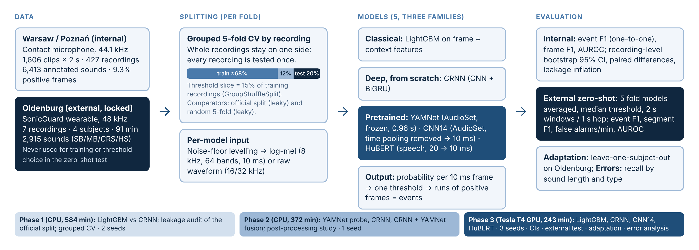

# Generalizable AI for Automated Bowel-Sound Detection

**A leakage-controlled comparison of classical, deep and pretrained audio models**

Akhilan S K (MD24B001) and Nithilarasu A P (MD24B026) · MD5001 AI in Medicine · IIT Madras · 2026

This repository contains the code, result tables and figures for our course project. The project detects bowel sounds in abdominal audio, one 10 ms frame at a time. It compares five models under leak-free evaluation and tests them zero-shot on a second recording device.



## Key results

| Finding | Number |
| --- | --- |
| Official test clips that come from recordings also used in training | 282 of 321 (88%) |
| Event F1 under grouped 5-fold CV (Warsaw): CNN14 · CRNN · LightGBM · HuBERT | 0.696 · 0.695 · 0.663 · 0.658 |
| YAMNet (1 s windows) probe, event F1 | 0.17–0.31 |
| Zero-shot event F1 on a new device (Oldenburg): CNN14 · HuBERT · CRNN · LightGBM | 0.755 · 0.734 · 0.677 · 0.552 |
| Frame-AUROC advantage of CNN14 over CRNN on the new device | +0.016 |
| Recall for sounds shorter than 15 ms (all models) | 0.46–0.54 |

The take-home message: learned features transfer to a new device better than decision thresholds do, so thresholds should be calibrated for each device.

## Repository layout

```
phase1/   LightGBM vs CRNN, leakage audit, grouped CV (CPU)       train_bowel.py + results/
phase2/   YAMNet probe, CRNN, CRNN+YAMNet fusion (CPU)            train_phase2.py + results/
phase3/   LightGBM, CRNN, CNN14, HuBERT; CIs; external test;      phase3.py + make_figs.py + results/
          leave-one-subject-out adaptation; error analysis (GPU)
figures/  study design figure
```

Each `results/` folder has the CSV tables used in the report. The `NOTES` file in each folder gives the run settings and a summary.

## Data (not included)

The audio is not redistributed here. Download it from the original sources and respect their licences:

- **Warsaw/Poznań (internal):** Kaggle dataset `robertnowak/bowel-sounds` (Ficek et al., *Sensors* 2021, doi:10.3390/s21227602). CC BY-NC 4.0, so non-commercial use only.
- **Oldenburg (external):** figshare doi:10.6084/m9.figshare.28595741 (Mansour et al.). CC BY 4.0. `phase3.py` downloads the 7 recordings from figshare automatically.

## How to run

The scripts were run as Kaggle notebooks: Phases 1–2 on CPU, Phase 3 on a Tesla T4 GPU.

```bash
pip install -r requirements.txt

# Phase 1: LightGBM vs CRNN, official and grouped splits (CPU, about 10 h)
python phase1/train_bowel.py --data /path/to/bowel-sounds --out out/phase1

# Phase 2: YAMNet (TensorFlow SavedModel from Kaggle Models google/yamnet) vs CRNN vs fusion (CPU, about 6 h)
python phase2/train_phase2.py --data /path/to/bowel-sounds --yamnet /path/to/yamnet --epochs 20 --seeds 1 --out out/phase2

# Phase 3: all models, 3 seeds, external test and adaptation (GPU, about 4 h)
python phase3/phase3.py --data /path/to/bowel-sounds --loso_seeds 1 --out out/phase3

# Re-draw the Phase 3 figures from the CSVs in phase3/results
python phase3/make_figs.py
```

Every script has a `--quick` flag for a short smoke test.

## Method in brief

- **Labels:** 200 frames of 10 ms per 2 s clip. A frame is positive if it overlaps an annotated sound (9.3% positive overall).
- **Splits:** GroupKFold by recording prefix (primary). The official split and a random split are reported for comparison. The threshold and best epoch are chosen on a 15% grouped validation slice of the training data only.
- **Models:**
  - LightGBM on 321 log-mel and context features.
  - CRNN (4 conv blocks + BiGRU).
  - YAMNet (frozen, 0.96 s windows).
  - CNN14 (PANNs, AudioSet). Pooling is changed to frequency-only so all 200 frames are kept.
  - HuBERT-base (speech, 20 ms frames, upsampled).
- **Metrics:**
  - Event F1 with one-to-one matching (primary).
  - Frame F1 and AUROC.
  - Recording-level bootstrap 95% CIs (1,000 resamples) and paired differences.
  - External test: segment F1 and false alarms per minute as well.

## Licence

The code is released under the MIT licence (see `LICENSE`). The datasets keep their own licences, listed above.

## Acknowledgements

We thank the authors of both public datasets. An AI assistant (Claude, Anthropic) helped write code, run analyses and draft documentation.
